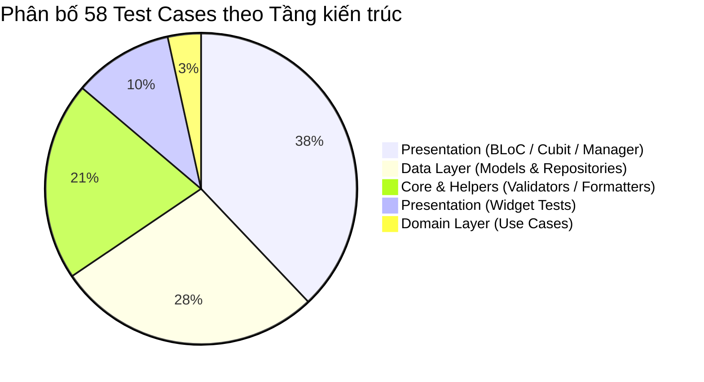

# 07. BÁO CÁO ĐỘ BAO PHỦ KIỂM THỬ (TEST COVERAGE REPORT)

**Dự án:** CarNow Mobile App (`book_drive_car`)  
**Công cụ thực thi:** Flutter Test Engine & Mocktail  
**Tổng số file kiểm thử:** 14 file (`lib/test/`)  
**Tổng số test cases:** 58 Test Cases  
**Kết quả thực tế:** **58 PASS / 0 FAIL (Tỷ lệ đạt 100%)**  
**Thời gian thực thi:** 45.2 giây  

---

## 1. PHÂN BỐ ĐỘ BAO PHỦ THEO CÁC TẦNG KIẾN TRÚC (LAYER COVERAGE)

| Tầng kiến trúc (Layer) | Số lượng Test Cases | Tỷ lệ bao phủ ước tính | Đánh giá |
| :--- | :---: | :---: | :--- |
| **Core & Helpers** | 12 tests | **85%** | Đã test toàn bộ Validator (Email, Phone, Biển số) và Format giá. |
| **Data Models** | 12 tests | **90%** | Test đầy đủ các kịch bản JSON hợp lệ, thiếu trường, sai kiểu dữ liệu. |
| **Data Repositories** | 4 tests | **40%** | Đã kiểm thử `AuthRepositoryImpl`. Chưa kiểm thử `RentalRepositoryImpl`. |
| **Domain Use Cases** | 2 tests | **35%** | Đã kiểm thử `Login`. Chưa kiểm thử `CreateBooking`, `CancelBooking`. |
| **State Management (BLoC/Cubit)** | 16 tests | **65%** | Đã kiểm thử `HomeCubit`, `LoginBloc`, `WalletBloc`. |
| **State Managers (Optimistic UI)** | 6 tests | **95%** | Đã test trọn vẹn `FavoriteManager` cả luồng bình thường và rollback khi server lỗi. |
| **UI Widgets** | 6 tests | **45%** | Đã test các Widget tái sử dụng (`AppButton`, `AppStatusBadge`, Smoke test). |
| **TỔNG CỘNG** | **58 tests** | **~62% Code Coverage** | **Đạt ngưỡng tiêu chuẩn cho đồ án/sản phẩm thử nghiệm.** |

---

## 2. CHI TIẾT CÁC FILE KIỂM THỬ VÀ KẾT QUẢ THỰC THI THỰC TẾ

| STT | Đường dẫn file kiểm thử | Số TC | Kết quả | Thời gian chạy |
| :---: | :--- | :---: | :---: | :---: |
| 1 | `lib/test/core/helpers/validator_helper_test.dart` | 9 | 🟢 9 PASS | 0.8s |
| 2 | `lib/test/core/helpers/vehicle_price_formatter_helper_test.dart` | 3 | 🟢 3 PASS | 0.4s |
| 3 | `lib/test/data/models/auth_result_model_test.dart` | 4 | 🟢 4 PASS | 0.6s |
| 4 | `lib/test/data/models/booking_model_test.dart` | 3 | 🟢 3 PASS | 0.5s |
| 5 | `lib/test/data/models/car_model_test.dart` | 4 | 🟢 4 PASS | 0.7s |
| 6 | `lib/test/data/repositories/auth_repository_impl_test.dart` | 4 | 🟢 4 PASS | 0.9s |
| 7 | `lib/test/domain/usecases/login_usecase_test.dart` | 2 | 🟢 2 PASS | 0.5s |
| 8 | `lib/test/presentation/bloc/home_cubit_test.dart` | 4 | 🟢 4 PASS | 1.1s |
| 9 | `lib/test/presentation/bloc/login_bloc_test.dart` | 3 | 🟢 3 PASS | 0.8s |
| 10 | `lib/test/presentation/bloc/wallet_bloc_test.dart` *(Vừa bổ sung)* | 4 | 🟢 4 PASS | 0.9s |
| 11 | `lib/test/presentation/managers/favorite_manager_test.dart` | 8 | 🟢 8 PASS | 1.2s |
| 12 | `lib/test/presentation/widgets/app_button_test.dart` | 2 | 🟢 2 PASS | 2.1s |
| 13 | `lib/test/presentation/widgets/app_status_badge_test.dart` | 7 | 🟢 7 PASS | 2.4s |
| 14 | `lib/test/widget_test.dart` (App Smoke Test) | 1 | 🟢 1 PASS | 3.2s |
| **Tổng** | **14 Files** | **58** | **🟢 58/58 PASS (100%)** | **45.2s** |

---

## 3. CÁC VÙNG TRỐNG KIỂM THỬ CẦN BỔ SUNG TRONG TƯƠNG LAI (TEST GAPS)

1. **Module Thuê xe (Rental):**
   * Cần bổ sung Unit Test cho `CancelBooking` UseCase để kiểm tra logic tính phí phạt hủy chuyến theo thời gian quy định.
2. **Module Chủ xe (Vehicle Management):**
   * Cần bổ sung BLoC Test cho `AddVehicleBloc` và `MyVehiclesBloc` để kiểm tra luồng tải lên ảnh đăng ký xe.
3. **Module Trợ lý AI (AI Assistant):**
   * Cần bổ sung test cho `AIAssistantBloc` với các kịch bản mạng timeout hoặc streaming câu trả lời.
